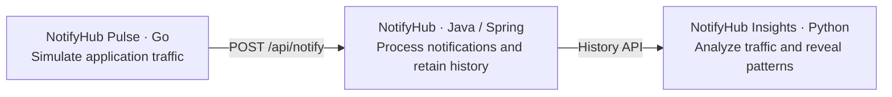

# NotifyHub Pulse

A small Go traffic simulator for the NotifyHub demo: **Go creates the traffic, Java processes it, Python explains it.**



Pulse is a standalone CLI using Go 1.25+ and the standard library. It sends ordinary notification requests through Java; Java records the receipt times and history that Insights reads.

## Run

Start the Java service in the sibling `notify-hub` project (`./mvnw spring-boot:run`), then run Pulse:

```sh
go run . run --scenario normal --rate 5 --duration 30s
go run . run --scenario campaign --rate 30 --duration 10s
go run . run --scenario duplicates --count 100
```

Or build the executable:

```sh
go build -o bin/pulse .
./bin/pulse run --scenario duplicates --count 100
```

| Scenario | Traffic | What to inspect in Insights |
| --- | --- | --- |
| `normal` | 60% email, 20% SMS, 20% push; varied order, delivery, account, and service messages | Baseline counts and channel distribution |
| `campaign` | 90% email, 5% SMS, 5% push; repeated autumn promotion emails at a higher rate | Increased volume and email share; similar campaign messages can also form a cluster |
| `duplicates` | Email payment reminders for the same invoice and recipient; changing reference numbers, case, punctuation, and a short suffix | A `Payment reminder` cluster with similar messages |

Mixes are exact over complete cycles (10 requests for normal, 20 for campaign). The same scenario always generates the same sequence. Short runs and cancellation may produce partial cycles. Normal traffic can also form repeated-message clusters in sufficiently long runs.

Preview the actual JSON payloads without a running service:

```sh
go run . run --scenario duplicates --count 3 --dry-run
```

Dry-run prints one JSON object per line with no pacing or network activity. For duration-based previews it prints `ceil(rate × duration)` payloads, the ideal planned count.

## Options and behavior

Run `go run . run --help` for all flags.

| Flag | Default | Meaning |
| --- | --- | --- |
| `--scenario` | `normal` | `normal`, `campaign`, or `duplicates` |
| `--base-url` | `http://localhost:8080` | Java base URL, optionally including a context path |
| `--rate` | `5` (`30` for duplicates) | Total requests per second across all workers; fractional rates allowed |
| `--duration` | `30s` | Scheduling window; mutually exclusive with explicit `--count` |
| `--count` | unset (`100` for duplicates) | Exact number of requests to attempt, unless canceled |
| `--workers` | `4` | Maximum in-flight HTTP requests |
| `--timeout` | `5s` | Per-request timeout |
| `--dry-run` | `false` | Print planned payloads and exit |

The first request starts immediately. Pacing is a best-effort ceiling; slow responses apply backpressure, so achieved throughput can be lower. At the end of a duration window Pulse stops scheduling and lets started requests finish within their timeouts. Ctrl+C or SIGTERM stops scheduling and cancels in-flight requests.

There are no retries. Each POST is independent. A timeout or canceled request may already have been processed by Java; its receipt remains uncertain until you inspect history. `accepted` requires HTTP 200, `success: true`, and a nonempty `notificationId`; it means simulated acceptance by Java. Pulse reports totals, counts per channel, mean/max HTTP latency, and up to three sample errors. Exit codes are `0` for success, `1` for request failures, `2` for invalid arguments, and `130` for cancellation.

Payloads contain only Java's supported `recipient`, `channel`, `subject`, and `body` fields. All identities are demo values. Pulse never supplies timestamps or writes directly to the database.

## IntelliJ demonstration

Open the three related projects in IntelliJ IDEA with their language support enabled. Configure Go 1.25+ as Pulse's SDK. This repository includes shared run configurations in `.run/`:

- **Pulse · Normal traffic**
- **Pulse · Campaign burst**
- **Pulse · Duplicate storm**
- **Pulse · Preview payloads**

1. Start Java on port 8080. In the Python project, install its dependencies (`uv sync`), build the dashboard (`npm ci` then `npm run build`), and start `main.py`. Insights defaults to http://localhost:5050.
2. Run **Normal traffic** from IntelliJ. Open Insights, select **Java history**, and press **Refresh** after the run. Observe the increased totals and channel counts.
3. Run **Campaign burst**, refresh, and inspect the increased email share. Use Pulse's console to show the higher request rate.
4. Run **Duplicate storm**, refresh, and inspect the **Payment reminder** cluster and its message variants. Insights' default minimum is 20 messages; this run sends 100.
5. Follow the same story through Go's `Scenario` and `Sender` interfaces, the worker pool and context cancellation, Java's notification controller/history, and Python's normalization and duplicate analysis. Run or debug a Go table-driven test from the gutter.

Insights currently groups the main traffic chart into **hourly buckets** and needs at least 12 prior hours for its anomaly baseline. A ten-second campaign increases the current hour's total; it does not produce its own ten-second spike or guarantee an anomaly marker. Short selectable buckets would be a separate Insights enhancement. The duplicate cluster and channel-count change work with the existing analysis.

Insights starts with synthetic demo data and caches Java history snapshots. Select **Java history** and explicitly **Refresh** after each run. Clear any hour selection and channel filter to see the whole run. Repeated runs accumulate in retained history and nearby payment-reminder runs can merge into one cluster. The current Insights adapter supports up to 5,000 history records.

For a different Java port, use `--base-url http://localhost:8081` in Pulse and `NOTIFY_HUB_URL=http://localhost:8081` when starting Insights.

## Code and checks

- `main.go`: process entry point and signal context.
- `internal/pulse/scenario.go`: deterministic business scenarios and JSON payloads.
- `internal/pulse/client.go`: context-aware HTTP transport and response validation.
- `internal/pulse/runner.go`: bounded worker pool, pacing, cancellation, and summaries.
- `internal/pulse/cli.go`: flags, previews, output, and exit codes.

```sh
go test -race ./...
go vet ./...
go build -o bin/pulse .
```

Tests cover the scenario mixes, the actual HTTP contract using `httptest`, failure/timeout handling, concurrency limits, pacing, duration draining, cancellation, and CLI exit codes.
